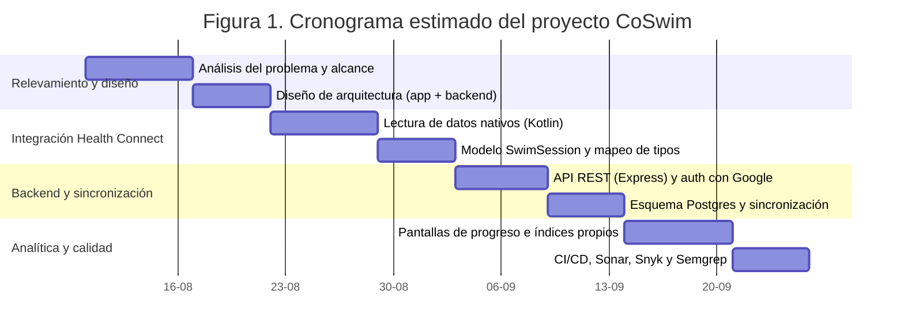
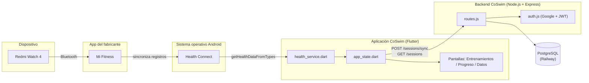

[comment]: 

**UNIVERSIDAD PRIVADA DE TACNA**

**FACULTAD DE INGENIERIA**

**Escuela Profesional de Ingeniería de Sistemas**

**Proyecto CoSwim**

Curso: *{Nombre de Asignatura}*

Docente: *Patricio Cuadros*

Integrantes:

***{Apellidos y nombres del estudiante (código universitario)}***

**Tacna – Perú**

***2026***

**  
**

\pagebreak

> Sistema *CoSwim*

> Informe de Factibilidad

> Versión *1.0*

|CONTROL DE VERSIONES||||||
| :-: | :- | :- | :- | :- | :- |
|Versión|Hecha por|Revisada por|Aprobada por|Fecha|Motivo|
|1\.0|Equipo CoSwim|Patricio Cuadros|Patricio Cuadros|09/10/2026|Versión original|

\pagebreak

# **INDICE GENERAL**

[1. Descripción del Proyecto](#_Toc52661346)

[2. Riesgos](#_Toc52661347)

[3. Análisis de la Situación actual](#_Toc52661348)

[4. Estudio de Factibilidad](#_Toc52661349)

[4.1 Factibilidad Técnica](#_Toc52661350)

[4.2 Factibilidad económica](#_Toc52661351)

[4.3 Factibilidad Operativa](#_Toc52661352)

[4.4 Factibilidad Legal](#_Toc52661353)

[4.5 Factibilidad Social](#_Toc52661354)

[4.6 Factibilidad Ambiental](#_Toc52661355)

[5. Análisis Financiero](#_Toc52661356)

[6. Conclusiones](#_Toc52661357)

\pagebreak

**<u>Informe de Factibilidad</u>**

1. **Descripción del Proyecto**

    1.1. Nombre del proyecto

    &nbsp;&nbsp;&nbsp;&nbsp;*CoSwim*: aplicación móvil de monitoreo y análisis de entrenamientos de natación.

    1.2. Duración del proyecto

    &nbsp;&nbsp;&nbsp;&nbsp;El desarrollo se planificó en 8 semanas, divididas en cuatro etapas (relevamiento y
    diseño, integración con Health Connect, backend y sincronización, y analítica/calidad).
    La Figura 1 muestra el cronograma estimado.

    1.3. Descripción

    &nbsp;&nbsp;&nbsp;&nbsp;Los relojes deportivos de gama media-baja (como el Redmi Watch 4 usado como
    referencia para este proyecto) registran métricas de natación — frecuencia cardiaca,
    saturación de oxígeno, calorías, pasos y sesiones de ejercicio — y las sincronizan hacia
    la aplicación del fabricante (Mi Fitness), que a su vez las publica en Health Connect,
    el repositorio de salud a nivel de sistema operativo en Android. Sin embargo, la
    aplicación del fabricante solo ofrece una lectura genérica de esos datos: no calcula
    índices de eficiencia propios del nadador, no agrupa los splits por cada 100 metros a
    partir de la serie de velocidad, y no permite comparar el desempeño de una sesión
    frente al histórico del mismo usuario.

    &nbsp;&nbsp;&nbsp;&nbsp;CoSwim nace para cubrir ese vacío: es una aplicación Flutter (Android) que lee
    los registros ya existentes en Health Connect — sin depender de hardware propio ni de
    un SDK de un fabricante específico —, los combina con un backend propio (Node.js +
    PostgreSQL, desplegado en Railway) para respaldarlos en la nube y verlos desde
    cualquier sesión autenticada con Google, y agrega sobre ellos métricas de analítica
    deportiva que Health Connect no calcula por sí solo: un índice de eficiencia propio,
    splits de 100 m reconstruidos a partir de la serie de velocidad, distribución de
    zonas de frecuencia cardiaca, carga de entrenamiento (estilo TRIMP) y recuperación de
    FC post-esfuerzo.

    &nbsp;&nbsp;&nbsp;&nbsp;El proyecto es relevante porque resuelve un problema real y verificado con
    hardware real (no es una maqueta): durante el desarrollo se depuraron fallas
    concretas de interoperabilidad entre Mi Fitness y Health Connect (permisos de
    Android mal declarados que impedían leer tipos de dato completos, ver sección 3.1),
    lo que demuestra que integrar wearables de terceros vía Health Connect es viable
    pero exige un trabajo de validación que la mayoría de apps de este tipo no hacen.

    1.4. Objetivos

    &nbsp;&nbsp;&nbsp;&nbsp;1.4.1 Objetivo general

    &nbsp;&nbsp;&nbsp;&nbsp;&nbsp;&nbsp;&nbsp;&nbsp;Desarrollar una aplicación móvil que lea, almacene y analice sesiones de
    natación sincronizadas desde Health Connect, ofreciendo al usuario métricas de
    rendimiento que su aplicación de reloj no calcula de forma nativa.

    &nbsp;&nbsp;&nbsp;&nbsp;1.4.2 Objetivos Específicos

    - Integrar la lectura de registros de Health Connect (frecuencia cardiaca,
      SpO2, calorías, pasos, distancia y sesiones de ejercicio) desde una app Flutter,
      validando qué permisos de Android corresponden a cada tipo de dato.
    - Diseñar e implementar un backend propio (API REST) que autentique usuarios con
      Google y centralice el historial de sesiones en una base de datos relacional,
      evitando que la app hable directo con la base de datos.
    - Calcular métricas de analítica deportiva propias (índice de eficiencia, splits de
      100 m, zonas de frecuencia cardiaca, carga de entrenamiento, recuperación de FC)
      a partir de series temporales que sí entrega Health Connect de forma consistente.
    - Incorporar un pipeline de integración continua con análisis estático de calidad
      y seguridad (SonarCloud, Snyk, Semgrep) sobre el código de la app y del backend.

\pagebreak

2. **Riesgos**

    &nbsp;&nbsp;&nbsp;&nbsp;A continuación se listan los riesgos identificados que podrían afectar el éxito
    del proyecto, junto con la estrategia de mitigación adoptada o planificada.

    |Riesgo|Probabilidad|Impacto|Mitigación|
    | :- | :-: | :-: | :- |
    |Los permisos de Android declarados para un `HealthDataType` no corresponden al permiso real que exige Health Connect (ya ocurrió con `SPEED` y con `BLOOD_OXYGEN`), bloqueando silenciosamente la lectura de **todos** los demás tipos.|Alta (ya materializado dos veces)|Alto|Pedir autorización tipo por tipo (un `getHealthDataFromTypes` por `HealthDataType`), para que un tipo mal declarado no tumbe la lectura del resto; verificar el permiso real contra el SDK (AAR de `connect-client`) en vez de adivinarlo por el nombre.|
    |El fabricante del reloj (Mi Fitness) no escribe en Health Connect todas las métricas que muestra en su propia app (p. ej. velocidad, SWOLF, VO2max estimado) para ciertos modos de ejercicio.|Alta (confirmado con evidencia de dumps de diagnóstico)|Medio|No depender de esas métricas; calcular alternativas propias con lo que sí llega siempre (distancia, duración, calorías, FC): índice de eficiencia, carga de entrenamiento, zonas de FC.|
    |`requestAuthorization` de Health Connect lanza una excepción de "operación no soportada" en ciertos dispositivos aun cuando la lectura de datos sí funciona.|Media|Alto|Aislar la llamada en un botón explícito de "Solicitar permisos" con `try/catch`, y no bloquear el flujo normal de lectura de datos con ese resultado.|
    |Cambios en el esquema de datos (nuevas series, p. ej. calorías o pasos por intervalo) rompen compatibilidad entre versiones de la app ya instaladas y el backend.|Media|Medio|`schema.sql` usa `ALTER TABLE ... ADD COLUMN IF NOT EXISTS` y se re-ejecuta completo en cada migración, manteniendo el script idempotente.|
    |Exposición de credenciales o datos de salud por errores de seguridad en la API (inyección, falta de autenticación, dependencias vulnerables).|Baja|Alto|Pipeline de CI con Semgrep (SAST), Snyk (dependencias y código) y SonarCloud (calidad) corriendo en cada push a `main`; autenticación JWT obligatoria en todos los endpoints salvo `/auth/google`.|
    |Retraso en la curva de aprendizaje de Health Connect / Flutter al tratarse de un equipo que recién integra wearables de terceros.|Media|Medio|Uso de datos reales de un dispositivo físico (Redmi Watch 4) desde etapas tempranas, en vez de datos simulados, para exponer antes los problemas reales de interoperabilidad.|

\pagebreak

3. **Análisis de la Situación actual**

    3.1. Planteamiento del problema

    &nbsp;&nbsp;&nbsp;&nbsp;Un nadador que entrena con un reloj deportivo de gama media (p. ej. Redmi
    Watch 4 + Mi Fitness) solo tiene acceso a lo que la app del fabricante decide mostrar:
    duración, calorías, frecuencia cardiaca promedio y, en el mejor de los casos, un mapa
    de piscina. No existe forma de ver splits por 100 m calculados sobre su propia serie de
    velocidad, ni un índice de eficiencia que relacione ritmo, frecuencia cardiaca y nivel
    del nadador, ni una vista de tendencia histórica entre sesiones.

    &nbsp;&nbsp;&nbsp;&nbsp;Durante la etapa de diagnóstico con hardware real se confirmaron, además,
    problemas de interoperabilidad no documentados por el fabricante:

    - **Permisos mal declarados en Android Health Connect.** `HealthDataType.SPEED`
      estaba en la lista de tipos solicitados sin tener un permiso Android válido
      (`android.permission.health.READ_SPEED` no existe como permiso independiente),
      lo que rompía silenciosamente `requestAuthorization` e impedía leer **todos** los
      demás tipos, incluyendo `WORKOUT`. Se corrigió retirando `SPEED` del flujo de
      autorización y pidiendo los tipos de uno en uno.
    - **Mismo patrón con `BLOOD_OXYGEN`.** El manifiesto declaraba
      `android.permission.health.READ_BLOOD_OXYGEN`, que tampoco existe; el permiso real
      es `android.permission.health.READ_OXYGEN_SATURATION` (confirmado extrayendo el AAR
      de `androidx.health.connect:connect-client`). El dato de SpO2 nunca aparecía como
      opción activable en Health Connect hasta corregir el manifiesto.
    - **Mi Fitness no exporta `SpeedRecord` para todos los modos de ejercicio.** En el
      modo de reloj "Prueba de umbral de lactato" (`exerciseType 74`), el 100% de los
      dumps de diagnóstico revisados muestran `"speed": {"status":"ok","samples":[]}`
      con permiso concedido: no es un bug de CoSwim, es una limitación del exportador del
      fabricante.
    - **Mi Fitness tampoco escribe siempre sesiones `WORKOUT` completas**, solo métricas
      individuales sueltas; esto obligó a construir un mecanismo de agrupación de
      puntos contiguos como sesión "auto-detectada" para ese caso.

    &nbsp;&nbsp;&nbsp;&nbsp;Estos hallazgos confirman que el problema no es solo de producto (falta de
    analítica), sino también de **integración confiable** con un ecosistema de salud que
    no está pensado para que terceros lean sus datos de forma completa y predecible.

    3.2. Consideraciones de hardware y software

    &nbsp;&nbsp;&nbsp;&nbsp;**Hardware.** No se requiere hardware propietario: cualquier reloj o pulsera que
    sincronice hacia Health Connect (directamente o vía la app de su fabricante) es una
    fuente de datos válida. El dispositivo de referencia usado durante el desarrollo fue
    un Redmi Watch 4 sincronizado mediante Mi Fitness. En el servidor no se requiere
    hardware dedicado: el backend corre como contenedor en la plataforma Railway (PaaS).

    &nbsp;&nbsp;&nbsp;&nbsp;**Software.** La solución se compone de tres capas evaluadas como técnicamente
    alcanzables con las herramientas disponibles para el equipo:

    - **Cliente móvil:** Flutter/Dart (Android como plataforma objetivo), paquete
      `health` (wrapper de Health Connect), `google_sign_in`, `flutter_secure_storage`
      y `fl_chart` para las visualizaciones.
    - **Backend:** Node.js 20 + Express, `pg` (PostgreSQL), `google-auth-library` para
      verificar el `idToken` de Google y `jsonwebtoken` para emitir JWT propios.
    - **Persistencia:** PostgreSQL gestionado por Railway, con series temporales
      (frecuencia cardiaca, velocidad, SpO2, calorías, pasos) almacenadas como columnas
      `JSONB`, dado que hoy ninguna consulta necesita filtrar dentro de esas series.
    - **Calidad/seguridad:** GitHub Actions como CI (`flutter analyze`, `flutter test`,
      verificación de sintaxis del backend), más SonarCloud, Snyk y Semgrep como
      análisis estático recurrentes.

\pagebreak

4. **Estudio de Factibilidad**

    &nbsp;&nbsp;&nbsp;&nbsp;El estudio de factibilidad se realizó construyendo primero un prototipo
    funcional contra hardware real (Redmi Watch 4) y contrastando los resultados contra
    los objetivos del proyecto. Fue revisado y aprobado por el docente del curso,
    Patricio Cuadros, como parte del seguimiento del proyecto.

    4.1. Factibilidad Técnica

    &nbsp;&nbsp;&nbsp;&nbsp;Todas las piezas técnicas del proyecto usan tecnología madura, gratuita (en
    capa de uso del proyecto) y ampliamente documentada: Flutter/Dart, Health Connect
    (parte del sistema operativo Android desde la versión 14, instalable como app en
    versiones anteriores), Node.js/Express y PostgreSQL. La Figura 2 resume la
    arquitectura técnica validada durante el desarrollo.

    &nbsp;&nbsp;&nbsp;&nbsp;La factibilidad técnica quedó demostrada en la práctica, no solo en el papel:
    se identificaron y corrigieron limitaciones reales de la integración (ver sección
    3.1) sin necesidad de cambiar de enfoque arquitectónico, lo que indica que la
    tecnología elegida es apta para el problema. El único riesgo técnico pendiente —la
    ausencia de `SpeedRecord` en ciertos modos de reloj— es una limitación del
    exportador del fabricante, no de la arquitectura de CoSwim, y ya está mitigada
    calculando los splits de 100 m solo cuando sí existe serie de velocidad.

    4.2. Factibilidad Económica

    &nbsp;&nbsp;&nbsp;&nbsp;El propósito de este análisis es estimar el costo de desarrollar y operar
    CoSwim en su etapa actual (proyecto académico con despliegue real en producción),
    frente a los beneficios de contar con analítica propia sin pagar licencias de
    software de terceros. Toda la infraestructura usada (Railway, PostgreSQL, Health
    Connect, GitHub Actions, SonarCloud, Snyk, Semgrep) opera dentro de niveles
    gratuitos para un proyecto de este tamaño, por lo que la inversión principal es de
    tiempo de desarrollo, no de licencias.

    &nbsp;&nbsp;&nbsp;&nbsp;4.2.1. Costos Generales

    |Concepto|Cantidad|Costo unitario (S/)|Costo total (S/)|
    | :- | :-: | :-: | :-: |
    |Conexión a internet (uso compartido, 2 meses)|2|80.00|160.00|
    |Energía eléctrica (equipos de desarrollo, 2 meses)|2|40.00|80.00|
    |Dispositivo wearable de referencia (Redmi Watch 4, ya disponible)|1|0.00 *(activo existente)*|0.00|
    |Útiles de oficina y documentación|1|30.00|30.00|
    |**Total costos generales**|||**270.00**|

    &nbsp;&nbsp;&nbsp;&nbsp;4.2.2. Costos operativos durante el desarrollo

    |Concepto|Costo mensual (S/)|Meses|Costo total (S/)|
    | :- | :-: | :-: | :-: |
    |Hosting backend (Railway, plan de uso incluido en capa gratuita/hobby)|0.00 – 20.00|2|0.00 – 40.00|
    |Base de datos PostgreSQL (addon de Railway, capa compartida)|0.00|2|0.00|
    |**Total costos operativos**|||**0.00 – 40.00**|

    &nbsp;&nbsp;&nbsp;&nbsp;4.2.3. Costos del ambiente

    &nbsp;&nbsp;&nbsp;&nbsp;&nbsp;&nbsp;&nbsp;&nbsp;No se requiere dominio propio (Railway entrega un subdominio
    `*.up.railway.app` incluido), ni infraestructura de red adicional a la conexión a
    internet ya contemplada en costos generales. El backend se expone sobre HTTPS
    gestionado por la plataforma, sin costo adicional para el volumen actual de uso.

    &nbsp;&nbsp;&nbsp;&nbsp;4.2.4. Costos de personal

    &nbsp;&nbsp;&nbsp;&nbsp;&nbsp;&nbsp;&nbsp;&nbsp;El desarrollo fue realizado por el equipo del proyecto como parte del
    curso, sin contratación de personal externo. Para fines de valorización del
    esfuerzo invertido, se estima el costo de oportunidad del tiempo dedicado:

    |Rol|Horas estimadas|Costo/hora referencial (S/)|Costo total (S/)|
    | :- | :-: | :-: | :-: |
    |Desarrollo móvil (Flutter + integración Health Connect)|60|25.00|1500.00|
    |Desarrollo backend (API + base de datos + despliegue)|35|25.00|875.00|
    |Analítica deportiva (índices, splits, pruebas con hardware real)|25|25.00|625.00|
    |Calidad y seguridad (CI/CD, Sonar, Snyk, Semgrep)|15|25.00|375.00|
    |Documentación del proyecto|15|20.00|300.00|
    |**Total costos de personal**|150|&nbsp;|**3675.00**|

    &nbsp;&nbsp;&nbsp;&nbsp;4.2.5. Costos totales del desarrollo del sistema

    |Rubro|Costo (S/)|
    | :- | :-: |
    |Costos generales|270.00|
    |Costos operativos (estimado máximo)|40.00|
    |Costos de personal (valorizado)|3675.00|
    |**Total estimado del proyecto**|**3985.00**|

    &nbsp;&nbsp;&nbsp;&nbsp;Al tratarse de un proyecto académico, no existe una forma de pago real
    asociada: el "costo" relevante para la toma de decisiones es el de infraestructura
    recurrente (S/ 0.00 – 40.00 mensuales), que es sostenible para continuar operando el
    sistema más allá del curso sin requerir financiamiento externo.

    4.3. Factibilidad Operativa

    &nbsp;&nbsp;&nbsp;&nbsp;CoSwim no depende de que el usuario mantenga ninguna infraestructura propia:
    solo necesita un teléfono Android con Health Connect y una cuenta de Google para
    autenticarse. La operación y el mantenimiento del backend quedan a cargo del equipo
    del proyecto mediante despliegues en Railway (`railway up --service backend`), y el
    esquema de base de datos está diseñado para migrar sin downtime (`ALTER TABLE ... ADD
    COLUMN IF NOT EXISTS`). Los interesados en el buen funcionamiento del sistema son:

    - El usuario final (nadador), interesado en ver su progreso sin fricción.
    - El equipo de desarrollo, interesado en mantener la app evolucionando sin romper
      compatibilidad con datos ya sincronizados.
    - El docente/evaluador del curso, interesado en verificar que el sistema funciona
      end-to-end con datos reales.

    4.4. Factibilidad Legal

    &nbsp;&nbsp;&nbsp;&nbsp;CoSwim trata datos de salud del usuario (frecuencia cardiaca, SpO2,
    calorías), por lo que aplican principios de protección de datos personales
    (en Perú, la Ley N.º 29733 de Protección de Datos Personales y su reglamento). El
    diseño actual reduce el riesgo legal de las siguientes formas: no se almacenan
    contraseñas (la identidad la verifica Google, solo se guarda el `sub` de la cuenta);
    el acceso a los datos de salud requiere autorización explícita del usuario a nivel de
    sistema operativo (Health Connect); y las credenciales de base de datos nunca viajan
    al dispositivo del usuario, todo pasa por la API propia. No se han identificado
    conflictos legales que impidan la operación del sistema en su alcance actual
    (proyecto académico con usuarios que consienten expresamente compartir sus datos).

    4.5. Factibilidad Social

    &nbsp;&nbsp;&nbsp;&nbsp;El proyecto no genera impacto social negativo: no reemplaza puestos de
    trabajo, no restringe el acceso a información pública y su uso es voluntario. Por el
    contrario, democratiza el acceso a analítica deportiva que normalmente está reservada
    a relojes de alta gama o a apps de pago, usando únicamente dispositivos de gama media
    ya extendidos en el mercado peruano.

    4.6. Factibilidad Ambiental

    &nbsp;&nbsp;&nbsp;&nbsp;El impacto ambiental es mínimo: no se requiere fabricar hardware adicional
    (se reutiliza el wearable que el usuario ya posee) y la huella del backend se limita
    al consumo energético de un servicio compartido en la nube (Railway), cuyo
    dimensionamiento actual (una API ligera + una base de datos pequeña) representa un
    consumo de cómputo marginal frente a alternativas on-premise.

\pagebreak

5. **Análisis Financiero**

    &nbsp;&nbsp;&nbsp;&nbsp;Dado que CoSwim es un proyecto académico sin modelo de monetización activo
    en su versión actual, el análisis financiero se plantea en términos de costo evitado
    y sostenibilidad operativa, más que de retorno monetario directo sobre una
    inversión de capital.

    5.1. Justificación de la Inversión

    &nbsp;&nbsp;&nbsp;&nbsp;5.1.1. Beneficios del Proyecto

    &nbsp;&nbsp;&nbsp;&nbsp;&nbsp;&nbsp;&nbsp;&nbsp;**Beneficios tangibles:**

    - Costo de infraestructura recurrente cercano a cero (capas gratuitas de Railway,
      GitHub Actions, SonarCloud, Snyk y Semgrep para proyectos de este tamaño).
    - Ahorro frente a adquirir un reloj de gama alta o una suscripción a una app de
      analítica deportiva de pago para obtener métricas equivalentes.
    - Reducción de tiempo de análisis manual del nadador: el índice de eficiencia, los
      splits de 100 m y las tendencias se calculan automáticamente por sesión.

    &nbsp;&nbsp;&nbsp;&nbsp;&nbsp;&nbsp;&nbsp;&nbsp;**Beneficios intangibles:**

    - Historial de entrenamiento centralizado y accesible desde cualquier sesión
      autenticada con Google, no atado a un solo teléfono.
    - Mejora en la toma de decisiones de entrenamiento al mostrar tendencias
      (mejorando/empeorando/estable) y récords personales.
    - Conocimiento técnico reutilizable sobre integración con Health Connect, útil
      para futuros proyectos del equipo que involucren wearables.

    &nbsp;&nbsp;&nbsp;&nbsp;5.1.2. Criterios de Inversión

    &nbsp;&nbsp;&nbsp;&nbsp;&nbsp;&nbsp;&nbsp;&nbsp;5.1.2.1. Relación Beneficio/Costo (B/C)

    &nbsp;&nbsp;&nbsp;&nbsp;&nbsp;&nbsp;&nbsp;&nbsp;&nbsp;&nbsp;&nbsp;&nbsp;Comparando el costo operativo recurrente estimado
    (S/ 0.00 – 40.00 mensuales) contra el costo evitado de una suscripción equivalente a
    una app de analítica deportiva de pago (referencialmente S/ 30.00 – 50.00
    mensuales) más el ahorro de no requerir un reloj de gama alta, la relación B/C es
    mayor a 1: el proyecto es aceptable desde este criterio.

    &nbsp;&nbsp;&nbsp;&nbsp;&nbsp;&nbsp;&nbsp;&nbsp;5.1.2.2. Valor Actual Neto (VAN)

    &nbsp;&nbsp;&nbsp;&nbsp;&nbsp;&nbsp;&nbsp;&nbsp;&nbsp;&nbsp;&nbsp;&nbsp;No aplica un cálculo formal de VAN en soles, dado que el
    proyecto no maneja flujos de ingreso monetario en su alcance actual (no es un
    producto comercial). Se reporta como referencia cualitativa: el valor generado
    (beneficios tangibles e intangibles descritos en 5.1.1) supera ampliamente el costo
    operativo recurrente cercano a cero, por lo que un eventual VAN calculado sobre
    costo evitado sería positivo.

    &nbsp;&nbsp;&nbsp;&nbsp;&nbsp;&nbsp;&nbsp;&nbsp;5.1.2.3 Tasa Interna de Retorno (TIR)

    &nbsp;&nbsp;&nbsp;&nbsp;&nbsp;&nbsp;&nbsp;&nbsp;&nbsp;&nbsp;&nbsp;&nbsp;Por la misma razón que el VAN, no corresponde calcular una
    TIR financiera tradicional. El costo de oportunidad de capital (COK) relevante aquí
    es el tiempo del equipo, ya valorizado en la sección 4.2.4; dado que la
    infraestructura recurrente no exige inversión de capital adicional, no existe una
    tasa de retorno de capital que evaluar en este alcance.

\pagebreak

6. **Conclusiones**

    - El proyecto es **técnicamente factible**: se validó con hardware real (Redmi
      Watch 4 + Mi Fitness + Health Connect) y se resolvieron limitaciones reales de
      interoperabilidad (permisos de Android mal declarados, ausencia de `SpeedRecord`
      en ciertos modos) sin cambiar el enfoque arquitectónico.
    - El proyecto es **económicamente factible**: opera dentro de capas gratuitas o de
      bajo costo de la infraestructura elegida (Railway, GitHub Actions, SonarCloud,
      Snyk, Semgrep), con un costo operativo recurrente estimado entre S/ 0.00 y S/
      40.00 mensuales.
    - El proyecto es **operativa, legal, social y ambientalmente factible**, al no
      requerir infraestructura dedicada del usuario, tratar los datos de salud con
      consentimiento explícito y no generar impacto negativo medible.
    - El principal riesgo residual —la dependencia de qué datos exporta cada
      fabricante de reloj a Health Connect— está mitigado con métricas propias
      calculables a partir de series que sí llegan de forma consistente (frecuencia
      cardiaca, distancia, duración, calorías).
    - En conjunto, el estudio de factibilidad respalda continuar con el desarrollo y
      la operación de CoSwim más allá del alcance académico actual.
