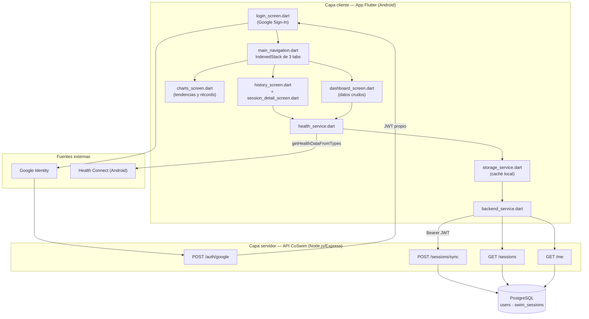
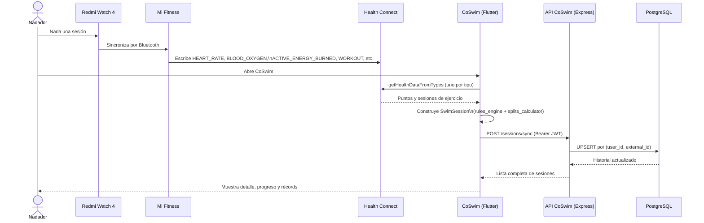
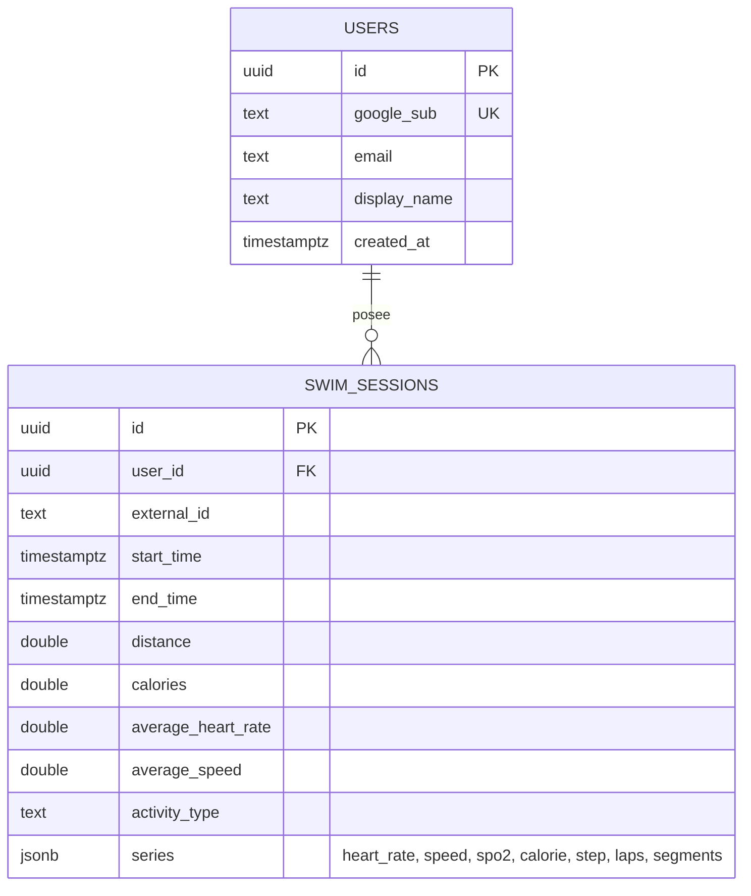

[comment]: 

**UNIVERSIDAD PRIVADA DE TACNA**

**FACULTAD DE INGENIERIA**

**Escuela Profesional de Ingeniería de Sistemas**

**Proyecto CoSwim**

Curso: *{Nombre de Asignatura}*

Docente: *Patricio Cuadros*

Integrantes:

***{Apellidos y nombres del estudiante (código universitario)}***

**Tacna – Perú**

***2026***

**  
**

\pagebreak

> Sistema *CoSwim*

> Documento de Visión

> Versión *1.0*

|CONTROL DE VERSIONES||||||
| :-: | :- | :- | :- | :- | :- |
|Versión|Hecha por|Revisada por|Aprobada por|Fecha|Motivo|
|1\.0|Equipo CoSwim|Patricio Cuadros|Patricio Cuadros|09/10/2026|Versión original|

\pagebreak

**INDICE GENERAL**
#
[1.	Introducción](#_Toc52661346)

1.1	Propósito

1.2	Alcance

1.3	Definiciones, Siglas y Abreviaturas

1.4	Referencias

1.5	Visión General

[2.	Posicionamiento](#_Toc52661347)

2.1	Oportunidad de negocio

2.2	Definición del problema

[3.	Descripción de los interesados y usuarios](#_Toc52661348)

3.1	Resumen de los interesados

3.2	Resumen de los usuarios

3.3	Entorno de usuario

3.4	Perfiles de los interesados

3.5	Perfiles de los Usuarios

3.6	Necesidades de los interesados y usuarios

[4.	Vista General del Producto](#_Toc52661349)

4.1	Perspectiva del producto

4.2	Resumen de capacidades

4.3	Suposiciones y dependencias

4.4	Costos y precios

4.5	Licenciamiento e instalación

[5.	Características del producto](#_Toc52661350)

[6.	Restricciones](#_Toc52661351)

[7.	Rangos de calidad](#_Toc52661352)

[8.	Precedencia y Prioridad](#_Toc52661353)

[9.	Otros requerimientos del producto](#_Toc52661354)

a) Estándares legales

b) Estándares de comunicación

c) Estándares de cumplimiento de la plataforma

d) Estándares de calidad y seguridad

[CONCLUSIONES](#_Toc52661355)

[RECOMENDACIONES](#_Toc52661356)

[BIBLIOGRAFIA](#_Toc52661357)

[WEBGRAFIA](#_Toc52661358)

\pagebreak

**<u>Informe de Visión</u>**

1. **Introducción**

    1.1 Propósito

    &nbsp;&nbsp;&nbsp;&nbsp;Este documento presenta la visión del sistema **CoSwim**: sus objetivos,
    el problema que resuelve, los interesados y usuarios involucrados, y las
    características de alto nivel del producto. Sirve como referencia común entre el
    equipo de desarrollo y el docente evaluador sobre qué construye el sistema y por
    qué, antes de entrar al detalle de requerimientos funcionales (documento FD03) y de
    arquitectura (documento FD04).

    1.2 Alcance

    &nbsp;&nbsp;&nbsp;&nbsp;El alcance de este documento cubre el sistema CoSwim completo: la
    aplicación móvil Flutter (Android) que lee datos de Health Connect y los presenta en
    tres vistas (Entrenamientos, Progreso, Datos), y el backend propio (API REST en
    Node.js/Express con base de datos PostgreSQL) que autentica usuarios con Google y
    centraliza el historial de sesiones de natación. No cubre el desarrollo de hardware
    propio ni de una aplicación de reloj: CoSwim consume datos ya sincronizados por la
    app del fabricante del wearable hacia Health Connect.

    1.3 Definiciones, Siglas y Abreviaturas

    |Término|Definición|
    | :- | :- |
    |Health Connect (HC)|Repositorio de datos de salud y actividad física a nivel de sistema operativo en Android, que centraliza lo que escriben distintas apps de salud/fitness.|
    |SwimSession|Modelo de dominio de CoSwim que representa una sesión de natación con sus series de datos (frecuencia cardiaca, velocidad, SpO2, calorías, pasos, laps/segmentos).|
    |SpO2|Saturación de oxígeno en sangre, medida por el sensor óptico del wearable.|
    |FC|Frecuencia cardiaca.|
    |JWT|JSON Web Token, usado por el backend de CoSwim para autenticar llamadas a la API tras el login con Google.|
    |TRIMP|*Training Impulse*, método de Edwards para estimar la carga de entrenamiento combinando tiempo en zonas de frecuencia cardiaca.|
    |Splits de 100 m|Tiempos parciales por cada 100 metros nadados, reconstruidos por CoSwim a partir de la serie de velocidad cuando esta existe.|
    |IndexedStack|Widget de Flutter que mantiene montadas simultáneamente varias pantallas y solo cambia cuál es visible, usado en la navegación principal de CoSwim.|
    |API REST|Interfaz del backend de CoSwim (`/auth/google`, `/me`, `/sessions`, `/sessions/sync`) consumida por la app móvil.|

    1.4 Referencias

    - `health_service.dart` — capa de lectura de Health Connect desde Flutter.
    - `backend/schema.sql` — esquema de base de datos PostgreSQL de CoSwim.
    - `backend/README.md` — documentación de endpoints y despliegue del backend.
    - Documentación oficial de [Health Connect (Android)](https://developer.android.com/health-and-fitness/guides/health-connect).
    - Documentación oficial de [Flutter](https://docs.flutter.dev/).

    1.5 Visión General

    &nbsp;&nbsp;&nbsp;&nbsp;El resto de este documento describe el posicionamiento del producto
    (sección 2), los interesados y usuarios (sección 3), la vista general del producto
    con su arquitectura (sección 4), sus características (sección 5), restricciones
    (sección 6), atributos de calidad (sección 7), precedencia de requerimientos
    (sección 8) y otros requerimientos no funcionales (sección 9).

\pagebreak

2. **Posicionamiento**

    2.1 Oportunidad de negocio

    &nbsp;&nbsp;&nbsp;&nbsp;Los relojes deportivos de gama media están cada vez más extendidos, pero
    sus apps oficiales ofrecen analítica limitada y, en el caso de natación, poco más
    que promedios globales de la sesión. Existe una oportunidad para una capa de
    software independiente del fabricante que, apoyándose en Health Connect como
    estándar común de Android, agregue valor analítico sin requerir hardware adicional
    ni suscripciones a plataformas de pago como las que ofrecen marcas de gama alta.

    2.2 Definición del problema

    |&nbsp;|&nbsp;|
    | :- | :- |
    |**El problema de**|la falta de analítica deportiva avanzada en la natación con wearables de gama media|
    |**Afecta a**|nadadores que entrenan con relojes como el Redmi Watch 4 y dependen de Mi Fitness u apps equivalentes del fabricante|
    |**El impacto de ello es**|desconocer su índice de eficiencia real, sus splits por 100 m, su distribución de esfuerzo por zonas de frecuencia cardiaca y su tendencia de mejora entre sesiones|
    |**Una solución exitosa sería**|una aplicación que lea los datos ya existentes en Health Connect, los respalde en un backend propio y calcule métricas de analítica deportiva propias sobre ellos, sin depender de que el fabricante del reloj las calcule por su cuenta|

\pagebreak

3. **Descripción de los interesados y usuarios**

    3.1 Resumen de los interesados

    |Nombre|Representa|Rol en el proyecto|
    | :- | :- | :- |
    |Equipo de desarrollo CoSwim|El proyecto|Diseña, implementa y mantiene la app y el backend.|
    |Docente del curso (Patricio Cuadros)|La institución académica|Revisa, aprueba y evalúa los entregables del proyecto.|
    |Usuario nadador|Los usuarios finales|Utiliza la app para registrar y analizar su progreso en natación.|

    3.2 Resumen de los usuarios

    |Nombre|Descripción|Responsabilidades|
    | :- | :- | :- |
    |Nadador recreativo o federado|Persona que entrena natación regularmente con un wearable compatible con Health Connect.|Autorizar el acceso a sus datos de salud, iniciar sesión con Google y revisar su historial y progreso en la app.|

    3.3 Entorno de usuario

    &nbsp;&nbsp;&nbsp;&nbsp;El usuario interactúa con CoSwim desde un teléfono Android con Health
    Connect instalado (nativo desde Android 14, o como app descargable en versiones
    anteriores) y con Mi Fitness (u otra app de wearable compatible) ya sincronizando
    datos hacia Health Connect. La app se usa principalmente después de cada sesión de
    entrenamiento, para revisar el detalle de lo nadado, y de forma periódica para
    revisar tendencias en la pestaña "Progreso".

    3.4 Perfiles de los interesados

    &nbsp;&nbsp;&nbsp;&nbsp;**Docente del curso.** Evalúa que el sistema cumpla los objetivos
    académicos del proyecto: integración real con un wearable, backend propio con
    autenticación segura, y analítica de datos no trivial. Su criterio de éxito es que
    el sistema funcione end-to-end con datos reales, no solo con datos simulados.

    3.5 Perfiles de los Usuarios

    &nbsp;&nbsp;&nbsp;&nbsp;**Nadador.** Usuario con conocimientos técnicos básicos (sabe usar apps de
    salud/fitness en su teléfono), interesado en mejorar su rendimiento. No espera
    configurar nada complejo: solo autenticarse con su cuenta de Google y otorgar los
    permisos de Health Connect que la app solicite.

    3.6 Necesidades de los interesados y usuarios

    |Necesidad|Prioridad|Preocupaciones|Solución actual|Solución propuesta|
    | :- | :-: | :- | :- | :- |
    |Ver el detalle de cada sesión de natación (FC, SpO2, splits, calorías)|Alta|La app del fabricante solo muestra promedios globales|Mi Fitness (datos genéricos)|`session_detail_screen.dart`: stats, índice de eficiencia, chart de FC, chart de SpO2, splits de 100 m|
    |Ver tendencia histórica de rendimiento entre sesiones|Alta|No hay forma de comparar sesiones entre sí|Ninguna|`charts_screen.dart`: charts históricos, tendencia del índice de eficiencia y récords personales|
    |No perder el historial si se cambia de teléfono|Media|Los datos de Health Connect son locales al dispositivo|Ninguna|Backend propio con sincronización (`/sessions/sync`) respaldado en PostgreSQL|
    |Confiar en que sus datos de salud están protegidos|Alta|Apps de terceros piden demasiados permisos o credenciales propias|N/A|Autenticación solo vía Google (sin contraseñas propias) + JWT propio + credenciales de BD nunca en el dispositivo|

\pagebreak

4. **Vista General del Producto**

    4.1 Perspectiva del producto

    &nbsp;&nbsp;&nbsp;&nbsp;CoSwim es un sistema cliente-servidor compuesto por una app Flutter y un
    backend propio en Node.js. La app nunca accede directo a la base de datos: todo pasa
    por la API, que a su vez verifica la identidad del usuario contra Google. La Figura 1
    muestra la arquitectura general del sistema.

    &nbsp;&nbsp;&nbsp;&nbsp;La Figura 2 detalla el flujo temporal de una sincronización típica, desde que
    el reloj registra la sesión hasta que queda disponible en el backend.

    &nbsp;&nbsp;&nbsp;&nbsp;La Figura 3 muestra el modelo de datos persistido en PostgreSQL.

    4.2 Resumen de capacidades

    |Beneficio para el usuario|Características que lo soportan|
    | :- | :- |
    |Ver el detalle completo de cada sesión|Stats de sesión, chart de FC, chart de SpO2, chart de calorías/pasos por intervalo, splits de 100 m|
    |Entender su eficiencia real, no solo promedios|Índice de eficiencia propio (`computeEfficiencyScore`), carga de entrenamiento estilo TRIMP, zonas de FC, recuperación de FC post-esfuerzo|
    |Ver su progreso en el tiempo|Pestaña "Progreso": charts históricos, tendencia del índice de eficiencia, récords personales (mejor 100 m, mayor distancia, mejor índice)|
    |No perder su historial al cambiar de dispositivo|Login con Google + sincronización con backend propio|
    |Confiar en la seguridad de sus datos|Sin contraseñas propias, JWT de 180 días, credenciales de BD nunca en el cliente|

    4.3 Suposiciones y dependencias

    - Se asume que el usuario tiene instalada y configurada una app de wearable
      (p. ej. Mi Fitness) que efectivamente sincroniza hacia Health Connect.
    - Se asume que el dispositivo Android soporta Health Connect (nativo desde Android
      14, o instalable en versiones anteriores desde Play Store).
    - CoSwim depende de que Health Connect otorgue los permisos de lectura solicitados;
      si el usuario los revoca, la app deja de poder leer datos nuevos hasta que se
      vuelvan a conceder.
    - El backend depende de la disponibilidad del servicio de Railway (hosting) y de la
      API de verificación de `idToken` de Google.

    4.4 Costos y precios

    &nbsp;&nbsp;&nbsp;&nbsp;CoSwim no tiene modelo de precios en su versión actual (proyecto
    académico de acceso gratuito). El detalle de costos de infraestructura y desarrollo
    se documenta en el Informe de Factibilidad (FD01), sección 4.2.

    4.5 Licenciamiento e instalación

    &nbsp;&nbsp;&nbsp;&nbsp;La app se distribuye como APK de Android (sin publicación en Play Store en
    esta etapa). El backend se despliega en Railway desde el repositorio del proyecto
    (`railway up --service backend`). El código fuente no declara actualmente una
    licencia de código abierto formal; se recomienda definirla antes de cualquier
    distribución pública (ver sección "Recomendaciones").

\pagebreak

5. **Características del producto**

    - **Autenticación con Google**, sin contraseñas propias, con sesión persistida de
      forma segura en el dispositivo (`flutter_secure_storage`).
    - **Lectura de Health Connect** tipo por tipo (frecuencia cardiaca, SpO2, calorías
      activas, distancia, sesiones de ejercicio), tolerante a que un tipo falle sin
      afectar a los demás.
    - **Historial de entrenamientos** en tarjetas, con navegación al detalle de cada
      sesión.
    - **Detalle de sesión** con estadísticas, índice de eficiencia propio, chart de FC,
      chart de SpO2 y splits de 100 m calculados desde la serie de velocidad.
    - **Pestaña de progreso** con charts históricos, tendencia del índice de eficiencia
      y sección de récords personales.
    - **Vista de datos crudos** (`dashboard_screen.dart`) para depuración y
      verificación de qué expone Health Connect realmente.
    - **Sincronización con backend propio**, con historial accesible desde cualquier
      sesión autenticada con la misma cuenta de Google.
    - **Métricas de analítica deportiva propias** no calculadas por el fabricante del
      wearable: distribución de zonas de FC, carga de entrenamiento (TRIMP), recuperación
      de FC post-esfuerzo, calorías por 100 m, intensidad promedio.

\pagebreak

6. **Restricciones**

    - La app solo funciona en dispositivos Android con Health Connect disponible; no
      hay versión iOS en el alcance actual (HealthKit de Apple no se integró).
    - Las métricas dependen de lo que el fabricante del wearable efectivamente escriba
      en Health Connect; CoSwim no puede calcular lo que nunca llega (p. ej. velocidad en
      ciertos modos de reloj).
    - El esquema de base de datos no tiene sistema de migraciones versionado: `schema.sql`
      se re-ejecuta completo y debe mantenerse idempotente (`ADD COLUMN IF NOT EXISTS`).
    - Las series temporales se guardan como `JSONB` sin indexación interna; no son aptas
      hoy para consultas analíticas del lado del servidor sobre puntos individuales.

\pagebreak

7. **Rangos de Calidad**

    |Atributo|Descripción|Verificación|
    | :- | :- | :- |
    |Confiabilidad de lectura|La falla de un tipo de dato de Health Connect no debe impedir leer los demás tipos.|Lectura tipo por tipo (`getHealthDataFromTypes` individual) ya implementada y validada con hardware real.|
    |Seguridad|Ningún endpoint de la API, salvo `/auth/google`, debe responder sin un JWT válido.|`requireAuth` middleware aplicado a `/me`, `/sessions`, `/sessions/sync`; verificado además por Semgrep/Snyk en cada push.|
    |Mantenibilidad|El esquema de base de datos debe poder evolucionar sin romper despliegues existentes.|`ALTER TABLE ... ADD COLUMN IF NOT EXISTS` + `schema.sql` idempotente.|
    |Usabilidad|Cambiar de pestaña no debe reiniciar el estado de carga de las otras pantallas.|Navegación con `IndexedStack` (las 3 pantallas se montan una sola vez).|
    |Calidad de código|El código debe pasar análisis estático sin hallazgos críticos sin resolver.|Pipeline de CI con SonarCloud, Snyk y Semgrep en cada push a `main`.|

\pagebreak

8. **Precedencia y Prioridad**

    &nbsp;&nbsp;&nbsp;&nbsp;El orden de implementación siguió la dependencia natural entre capas:
    primero la lectura confiable de Health Connect (sin eso no hay datos que mostrar),
    luego el modelo de dominio y las métricas de analítica, luego el backend y la
    sincronización, y por último la capa de calidad/seguridad continua.

    |Prioridad|Característica|Justificación|
    | :-: | :- | :- |
    |1 (crítica)|Lectura confiable de Health Connect, tipo por tipo|Sin datos de entrada no existe producto; además ya causó dos incidentes de permisos mal declarados.|
    |2 (alta)|Modelo `SwimSession` y métricas propias (índice de eficiencia, splits, zonas de FC)|Es la propuesta de valor diferencial frente a la app del fabricante.|
    |3 (alta)|Backend con autenticación Google y sincronización|Necesario para no perder el historial al cambiar de dispositivo.|
    |4 (media)|Pestaña de progreso y récords históricos|Depende de tener ya varias sesiones sincronizadas.|
    |5 (media)|Pipeline de CI con análisis de calidad y seguridad|No bloquea el uso funcional, pero es requisito de calidad del proyecto.|

\pagebreak

9. **Otros requerimientos del producto**

    a) Estándares legales

    &nbsp;&nbsp;&nbsp;&nbsp;Tratamiento de datos de salud conforme a principios de minimización y
    consentimiento explícito (Ley N.º 29733 de Protección de Datos Personales, Perú):
    el usuario autoriza expresamente qué tipos de dato puede leer la app a nivel de
    Health Connect, y puede revocar ese acceso en cualquier momento desde el sistema
    operativo.

    b) Estándares de comunicación

    &nbsp;&nbsp;&nbsp;&nbsp;Toda comunicación entre la app y el backend ocurre sobre HTTPS, con
    autenticación `Bearer` JWT en cada llamada protegida. El formato de intercambio es
    JSON, usando las mismas claves que `SwimSession.toJson()` en el cliente, de modo que
    el backend no requiere una capa de traducción adicional.

    c) Estándares de cumplimiento de la plataforma

    &nbsp;&nbsp;&nbsp;&nbsp;La app sigue los lineamientos de Android para apps de salud: solicita
    permisos de Health Connect de forma explícita y granular, y no accede a datos de
    salud sin autorización concedida por el usuario a través del selector del sistema
    operativo.

    d) Estándares de calidad y seguridad

    &nbsp;&nbsp;&nbsp;&nbsp;El repositorio ejecuta en cada push a `main`: `flutter analyze` y
    `flutter test` sobre la app; verificación de sintaxis sobre los módulos del backend;
    análisis de calidad de código con SonarCloud; análisis de dependencias y SAST con
    Snyk; y análisis estático adicional con Semgrep, cuyos resultados se publican como
    *code scanning alerts* del repositorio.

\pagebreak

**CONCLUSIONES**

- CoSwim resuelve una necesidad real y verificada con hardware físico: la falta de
  analítica deportiva avanzada en wearables de gama media para natación.
- La arquitectura cliente-servidor (Flutter + API propia + PostgreSQL), con
  autenticación delegada a Google, cumple los atributos de calidad definidos sin
  requerir que el cliente acceda nunca directo a la base de datos.
- Las métricas propias de analítica (índice de eficiencia, splits de 100 m, zonas de
  FC, carga de entrenamiento, recuperación de FC) son la propuesta de valor
  diferencial frente a la app del fabricante del wearable.
- Las limitaciones encontradas durante el desarrollo (permisos de Health Connect mal
  declarados, ausencia de `SpeedRecord` en ciertos modos) son del ecosistema de
  terceros, no del diseño de CoSwim, y ya están mitigadas en el código actual.

\pagebreak

**RECOMENDACIONES**

- Definir una licencia de código abierto formal antes de cualquier distribución
  pública del repositorio.
- Evaluar un sistema de migraciones versionado (p. ej. `node-pg-migrate`) si el
  esquema de base de datos crece en complejidad más allá de columnas aditivas.
- Explorar la normalización de las series `JSONB` en tablas propias únicamente si en
  el futuro se necesitan consultas analíticas sobre puntos individuales (p. ej.
  "todas las sesiones con un pico de FC > X"), tal como ya se previó en el diseño
  actual del esquema.
- Evaluar soporte para iOS/HealthKit si el proyecto escala más allá del alcance
  académico actual.

\pagebreak

**BIBLIOGRAFIA**

Edwards, S. (1993). *The heart rate monitor book*. Polar Electro Oy.

Jacobson, I., Booch, G., & Rumbaugh, J. (1999). *The unified software development
process*. Addison-Wesley.

Ley N.º 29733 (2011). *Ley de Protección de Datos Personales*. Congreso de la
República del Perú.

\pagebreak

**WEBGRAFIA**

Google. (s. f.). *Health Connect developer guide*. Android Developers. Recuperado el
9 de octubre de 2026, de https://developer.android.com/health-and-fitness/guides/health-connect

Google. (s. f.). *Flutter documentation*. Recuperado el 9 de octubre de 2026, de
https://docs.flutter.dev/

Railway. (s. f.). *Railway documentation*. Recuperado el 9 de octubre de 2026, de
https://docs.railway.com/

\pagebreak

