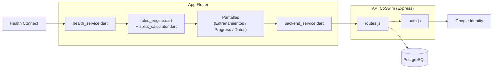

**UNIVERSIDAD PRIVADA DE TACNA**

**FACULTAD DE INGENIERIA**

**Escuela Profesional de Ingeniería de Sistemas**

**Proyecto CoSwim**

Curso: *{Nombre de Asignatura}*

Docente: *Patricio Cuadros*

Integrantes:

***{Apellidos y nombres del estudiante (código universitario)}***

**Tacna – Perú**

***2026***

\pagebreak

> Sistema *CoSwim*

> Documento de Arquitectura de Software (SAD)

> Versión *1.0*

|CONTROL DE VERSIONES||||||
| :-: | :- | :- | :- | :- | :- |
|Versión|Hecha por|Revisada por|Aprobada por|Fecha|Motivo|
|1\.0|Equipo CoSwim|Patricio Cuadros|Patricio Cuadros|09/10/2026|Versión original|

\pagebreak

# **INDICE GENERAL**

[1. Introducción](#_Toc1)

[2. Objetivos y Restricciones Arquitectónicas](#_Toc2)

[3. Vista Lógica](#_Toc3)

[4. Vista de Despliegue](#_Toc4)

[5. Patrones y Decisiones de Diseño](#_Toc5)

[6. Conclusiones](#_Toc6)

\pagebreak

**<u>Documento de Arquitectura de Software</u>**

1. **Introducción**

    &nbsp;&nbsp;&nbsp;&nbsp;Este documento describe la arquitectura de **CoSwim** usando una vista
    lógica (componentes y sus relaciones) y una vista de despliegue (dónde corre cada
    pieza). El propósito es dejar explícitas las decisiones estructurales: por qué el
    cliente nunca habla directo con la base de datos, por qué las series de datos se
    guardan como JSONB, y cómo se aísla la lectura de Health Connect para que un tipo de
    dato roto no tumbe a los demás.

\pagebreak

2. **Objetivos y Restricciones Arquitectónicas**

    |Objetivo/Restricción|Descripción|
    | :- | :- |
    |Aislar la base de datos del cliente|El teléfono nunca tiene credenciales de PostgreSQL; toda escritura/lectura pasa por la API propia.|
    |Tolerancia a fallas de Health Connect|La lectura se hace tipo por tipo (`getHealthDataFromTypes` individual), no en un solo batch, para que un tipo mal declarado no bloquee a los demás.|
    |Costo de infraestructura mínimo|Toda la infraestructura (Railway, GitHub Actions, SonarCloud, Snyk, Semgrep) debe operar en capas gratuitas o de bajo costo.|
    |Esquema evolutivo sin downtime|`schema.sql` debe poder re-ejecutarse completo de forma idempotente (`ADD COLUMN IF NOT EXISTS`).|
    |Plataforma objetivo|Android con Health Connect disponible (nativo desde Android 14, instalable en versiones previas); no hay vista iOS en este alcance.|

\pagebreak

3. **Vista Lógica**

    &nbsp;&nbsp;&nbsp;&nbsp;La Figura 1 muestra los componentes principales del sistema y sus
    dependencias: la capa cliente (Flutter), la capa servidor (API Express) y las fuentes
    externas (Google Identity y Health Connect).

    &nbsp;&nbsp;&nbsp;&nbsp;Componentes clave: `health_service.dart` encapsula toda la lectura de Health
    Connect; `rules_engine.dart` y `splits_calculator.dart` calculan las métricas propias
    (índice de eficiencia, zonas de FC, splits de 100 m) sin depender de Health Connect
    más allá de las series ya leídas; `backend_service.dart` es el único punto de la app
    que habla con la red hacia la API; `routes.js` expone los 4 endpoints (`/auth/google`,
    `/me`, `/sessions`, `/sessions/sync`) y delega la verificación de JWT en `auth.js`.

\pagebreak

4. **Vista de Despliegue**

    |Nodo|Contenido|Notas|
    | :- | :- | :- |
    |Dispositivo Android del usuario|App Flutter (APK) + Health Connect + Mi Fitness|Sin credenciales de base de datos.|
    |Railway (servicio backend)|API Node.js/Express|Expuesta por HTTPS en `*.up.railway.app`; deploy con `railway up --service backend`.|
    |Railway (addon PostgreSQL)|Base de datos `users` / `swim_sessions`|Compartida solo con el servicio backend dentro del mismo proyecto de Railway.|
    |GitHub Actions|CI: `flutter analyze`/`test`, verificación de sintaxis del backend, SonarCloud, Snyk, Semgrep|Corre en cada push a `main`.|

\pagebreak

5. **Patrones y Decisiones de Diseño**

- **Backend for Frontend simplificado:** la API existe principalmente para que el
  cliente nunca acceda directo a la base de datos, no para servir a múltiples clientes
  distintos.
- **JSONB para series temporales:** las series (FC, velocidad, SpO2, calorías, pasos)
  se guardan tal cual las produce la app, sin normalizar en tablas propias, porque hoy
  nada las consulta por dentro de la base de datos.
- **Upsert por clave de negocio:** `UNIQUE (user_id, external_id)` + `ON CONFLICT DO
  UPDATE` resuelve la sincronización repetida de la misma sesión sin lógica adicional
  en la app.
- **Lectura desacoplada por tipo de dato:** cada `HealthDataType` se pide por separado
  a Health Connect, aislando fallas de permisos de un tipo específico.
- **Sin sistema de migraciones dedicado:** se optó por un `schema.sql` idempotente en
  vez de herramientas como `node-pg-migrate`, dado el tamaño actual del esquema.

\pagebreak

6. **Conclusiones**

- La arquitectura cliente-servidor con API propia cumple el objetivo de aislar la base
  de datos del dispositivo del usuario.
- La lectura desacoplada por tipo de dato de Health Connect es la decisión de diseño
  que más impacto tuvo en la confiabilidad del sistema, al prevenir que un permiso mal
  declarado bloquee la lectura completa.
- El esquema JSONB simplifica el desarrollo actual; si en el futuro se requieren
  consultas analíticas sobre puntos individuales de las series, esta decisión deberá
  revisarse.
